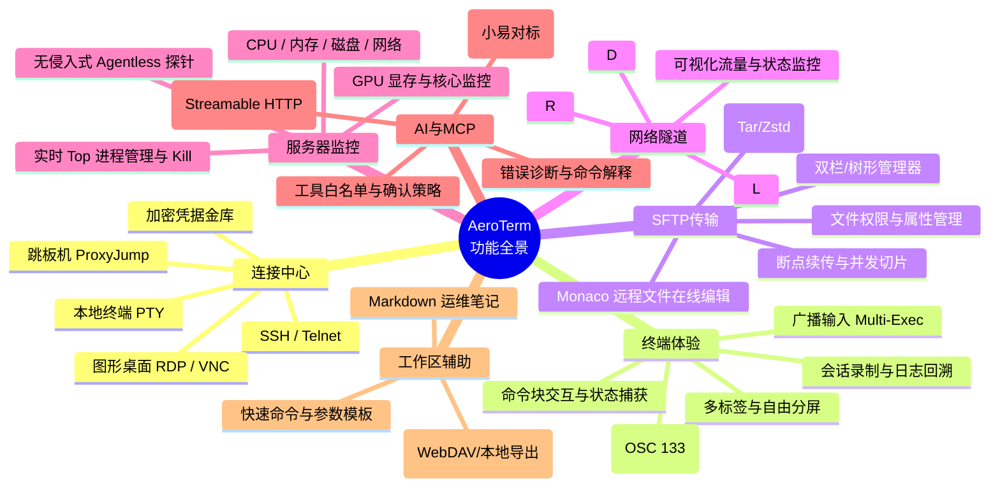
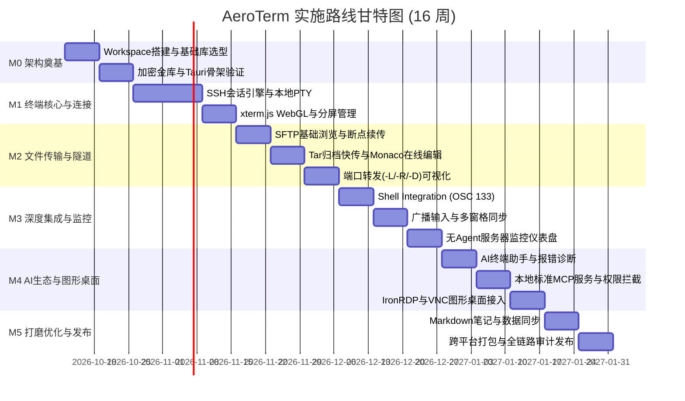

# Product Roadmap & Implementation Schedule: AeroTerm Workstation

> **项目名称**：`AeroTerm`（基于 Rust 构建的现代化极客级跨平台终端与服务器管理工作站）  
> **技术核心**：Rust 2024 / Cocoa WebKit / Tokio / Russh / xterm.js / IronRDP / Agentless Monitor / Local MCP Server  
> **文档归档**：`doc/product_roadmap_and_schedule.md`

---

## 1. 产品定位与目标概述

### 1.1 产品愿景
打造一款**纯 Rust 核心驱动、极致性能、内存安全、零知识端到端加密、AI 原生与 MCP 互联**的下一代多协议终端与服务器管理工作站。

解决现有基于 Electron 架构终端工具（如 Termius、Electerm、Tabby 等）普遍存在的**内存占用高（动辄 500MB~1GB）、启动缓慢、高并发 SSH/SFTP 传输卡顿、安全审计弱**等痛点；同时克服纯 C/C++ 传统工具（如 Xshell、SecureCRT、WindTerm）界面现代化程度不足、缺乏 AI 智能体生态与 MCP 扩展能力的缺陷。

### 1.2 核心指标对比

| 指标维度 | 传统 Electron 终端 | 传统 C/C++ 终端 (Xshell/CRT) | 本产品 (AeroTerm / Rust + WebKit) |
| :--- | :--- | :--- | :--- |
| **安装包体积** | 120MB ~ 250MB | 30MB ~ 60MB | **< 25MB** (超轻量打包) |
| **冷启动时间** | 1.8s ~ 3.5s | 0.8s ~ 1.5s | **< 0.4s** (毫秒级即开即用) |
| **空闲内存占用** | 350MB ~ 800MB | 60MB ~ 120MB | **< 45MB** (Rust 零运行时开销) |
| **高吞吐吞吐能力** | JS 单线程阻塞，大文件 SFTP 丢包降速 | 高性能但易出现内存越界/C 崩溃 | **多线程 Tokio 异步驱动，跑满千兆/万兆带宽** |
| **安全机制** | 明文/简易对称加密，内存明文留存 | 本地专有加密 | **Argon2id + AES-256-GCM 零知识加密 + zeroize 内存擦除** |
| **AI 与 MCP 原生度** | 外部插件或简易 WebView 套壳 | 基本无原生支持 | **内置 AI 诊断助手 + 原生标准 MCP Streamable HTTP 协议服务** |
| **跨平台支持** | 跨平台，但各端体验沉重 | Windows 优先，Mac/Linux 阉割或缺失 | **macOS (Apple Silicon & Intel) / Windows / Linux 真正原生跨平台** |

---

## 2. 详细功能矩阵（全景能力）



### 2.1 连接管理与凭据金库 (Connection Center & Vault)
1. **多协议统一入口**：
   - **SSH 2.0**：支持密码、公私钥对（RSA、Ed25519、ECDSA）、PKCS#8、带 Passphrase 私钥、交互式键盘认证（Keyboard-Interactive）、2FA / TOTP、每次连接时临时询问。
   - **本地终端**：本地原生 Shell 接入（macOS/Linux: zsh/bash/fish；Windows: PowerShell/CMD/WSL2）。
   - **图形远程桌面**：Windows RDP、Linux/macOS VNC。
   - **网络设备运维**：Telnet、Serial 串口（扩展支持交换机/路由器调试）。
2. **多跳网络穿透**：
   - 支持多级 ProxyJump（跳板机/堡垒机），自动链式隧道协商。
   - 支持前置 HTTP / SOCKS5 代理网关。
3. **零知识加密凭据金库**：
   - 主密码（Master Password）机制，保护整个资产库。
   - 凭据解耦：支持创建独立的“身份凭据（Credentials）”，并在多台服务器之间复用，修改凭据一处生效。
   - 会话锁屏保护与超时自锁机制。
4. **资产组织与导入导出**：
   - 树形多级分组、标签（Tags）、收藏夹、最近访问、快速拼音与模糊搜索。
   - 兼容 OpenSSH `~/.ssh/config`、Termius、FinalShell 等格式数据导入与加密导出。

### 2.2 现代终端核心交互 (Modern Terminal Experience)
1. **多维度视窗布局**：
   - 多标签页管理，支持标签颜色标记、重命名与拖拽排序。
   - 自由多窗格分屏（水平切分、垂直切分、网格切分），支持双击最大化单个窗格。
2. **广播同步输入 (Broadcast Input)**：
   - 支持将当前键盘输入广播至当前窗口所有分屏、指定标签组或所有活跃终端，实现集群批量运维与同态执行。
3. **Shell Integration (OSC 133 语义感知)**：
   - 深度感知 Shell 状态：自动识别 Prompt 起始（OSC 133;A）、命令输入起始（OSC 133;B）、执行结束与退出码（OSC 133;D;{ExitCode}）、当前工作目录切换（OSC 7）。
   - **命令块 (Command Block)**：
     - 每个执行命令作为独立 UI 块，支持一键折叠超长输出。
     - 明确标记执行成功（绿色）与执行失败返回码（红色）。
     - 一键拷贝执行命令、一键拷贝输出内容、一键重新执行。
4. **渲染与视觉美学**：
   - GPU 硬件加速渲染，流畅支持 120Hz/144Hz 高刷新率，无输入延迟。
   - 完整支持 24-bit TrueColor、Powerline 字体符、Nerd Fonts 连字、Sixel / Kitty 协议图形输出。
   - 内置多套精美深浅色主题（Catppuccin、Dracula、One Dark、Tokyo Night、Nord 等）。
5. **会话审计与持久化**：
   - 支持按会话记录完整原始日志、支持导出标准 Asciinema 动画格式，便于事后复盘与合规审计。

### 2.3 高性能 SFTP 文件传输与在线编辑 (SFTP & Transfer)
1. **现代双栏/单栏图形化管理器**：
   - 树形层级浏览、路径面包屑、快捷进入根目录/家目录/常用书签。
   - 支持多文件批量拖拽上传、下载、删除、移动、重命名。
2. **海量小文件流式归档快传 (Tar/Zstd 智能加速)**：
   - 传统 SFTP 传输上千个小文件由于往返延迟极慢。AeroTerm 内置智能打包算法：本地在内存中流式 tar 打包并通过 SSH 管道流式发往远端解压，传输速度提升 10~50 倍。
3. **稳健传输队列**：
   - 支持并发多块传输、大文件断点续传、文件校验（MD5/SHA256）。
   - 冲突处理策略：覆盖、跳过、自动重命名、按时间与大小智能比对。
4. **远程文件在线编辑**：
   - 内置专业级 Monaco Editor（VS Code 同款内核），支持 50+ 编程语言高亮与格式化。
   - 支持快捷键 `Ctrl+S` / `Cmd+S` 实时原子更新远端文件，支持本地缓存防丢。
   - 提供修改 Diff 对比视图，保存前清晰审查变更行。

### 2.4 网络隧道与端口转发 (Port Forwarding & Tunnels)
1. **三大转发模式全面支持**：
   - **本地转发 (Local, -L)**：将本地端口映射到远程服务器内部网络，安全访问内网数据库（MySQL/Redis）或 Web 服务。
   - **远程转发 (Remote, -R)**：将本地开发机服务暴露给远程服务器访问（内网穿透）。
   - **动态代理 (Dynamic SOCKS5, -D)**：本地开启 SOCKS5 代理服务器，将本地网络流量借由 SSH 隧道无缝路由。
2. **可视化监控管理**：
   - 隧道连接状态监控、实时流量统计（上传/下载速率与累计数据量）、活跃连接列表、一键启停与自动重连机制。

### 2.5 图形远程桌面 (Remote Desktop GUI)
1. **Windows RDP 客户端**：
   - 基于纯 Rust `ironrdp` 协议栈或底层高性能连接，支持多分辨率自适应、动态缩放、全屏切换。
   - 双向剪贴板同步（文本与文件映射）。
2. **Linux / macOS VNC 客户端**：
   - RFB 协议深度优化，支持帧缓冲压缩、色深调节、低带宽流畅模式。
3. **统一资产纳管**：
   - RDP 与 VNC 资产与 SSH 资产一视同仁，统一在连接中心配置分组、标签与加密凭据。

### 2.6 无侵入式服务器监控 (Agentless Server Monitor)
1. **免安装 Agent (Zero-Agent Overhead)**：
   - 运维服务器无需事先安装任何常驻客户端或开通额外端口，利用既有 SSH 连接复用通道进行采样。
2. **轻量高性能数据采集引擎**：
   - 周期性调用轻量采集脚本，直接解析 Linux `/proc/stat`、`/proc/meminfo`、`/proc/diskstats`、`/proc/net/dev`、`uptime`、`ps` 等原生内核接口。
   - 单次采样开销 < 0.1% CPU，流量 < 1KB/次。
3. **可视化仪表盘**：
   - 实时动态折线图：系统负载、CPU 多核占用、物理内存与 Swap、网络上下行瞬时带宽、磁盘分区占用率与读写 IOPS。
   - GPU 监控：自动探测并在支持的主机上渲染 Nvidia 显卡温度、显存占用与算力使用率。
4. **交互式进程管理器**：
   - 实时进程列表展示，支持按 CPU%、内存%、PID 动态排序。
   - 进程树查看，支持直接右键发送 `SIGTERM` / `SIGKILL` 终止异常进程。

### 2.7 AI 终端助手与本地 MCP 运行时生态 (AI & Model Context Protocol)
1. **智能终端助手（对标“小易”）**：
   - **自然语言转命令**：输入运维需求（如“查找大于 100M 且 7 天未修改的文件并打包”），自动生成正确 Shell 脚本。
   - **报错智能诊断**：终端命令退出码非 0 时，自动捕获 Stderr，一键触发 AI 解析原因并给出修复命令。
   - **命令沙箱解释**：对于复杂或高危命令（如 `iptables`、`awk`、`rm -rf`），提供逐句解析与安全告警。
   - **主流模型生态兼容**：无缝对接 OpenAI、Claude、DeepSeek、阿里通义千问、Ollama 本地大模型。
2. **本地标准 MCP (Model Context Protocol) 服务**：
   - **Streamable HTTP / SSE 协议实现**：AeroTerm 本地监听（默认 `127.0.0.1:12335`），向外部客户端（Claude Code、Codex、Cursor、Agentic Tools 等）暴露终端工具能力。
   - **多层次安全访问控制**：
     - **主机白名单**：精细控制允许外部客户端访问的远程主机与本地目录范围。
     - **工具分组策略**：可单独启用/停用 `terminal_exec`（命令执行）、`file_read`（读取文件）、`file_write`（修改文件）、`workspace_ops`。
     - **人机交互确认（Human-in-the-loop）**：对于敏感命令、`sudo` 操作、文件修改，强制弹出 GUI 确认弹窗，倒计时与参数安全审计，杜绝 Agent 失控越权。
     - **凭据绝不泄露**：MCP 服务只代为执行通道，绝对不向外部客户端暴露服务器密码或私钥明文。

### 2.8 运维笔记与辅助工具 (Workspace & Snippets)
1. **Markdown 运维知识库**：
   - 笔记与服务器/分组深度绑定，实时查阅部署文档、架构图、环境端口映射表。
2. **快速命令与参数化模板**：
   - 常用脚本库，支持动态变量插值（例如 `docker logs -f --tail={{lines:100}} {{container_name}}`）。
   - 点击运行时自动弹出参数填充弹窗，校验后回填执行。
3. **数据同步与备份**：
   - 支持本地密码库强加密导出/导入。
   - 支持 WebDAV / 自建轻量同步服务，实现多终端端到端加密同步。

---

## 3. 技术路线与架构设计

### 3.1 总体架构选型评估

经过对 Rust 客户端生态的严谨技术评估，架构选型对比如下：

| 选型方案 | 优势 | 劣势 | 结论 |
| :--- | :--- | :--- | :--- |
| **方案 A：纯 Rust 原生 GUI**<br/>(egui / Iced / Slint) | 纯 Rust 实现，单一二进制依赖极少 | 缺少成熟终端仿真器（没有完备的 OSC 133、Sixel、CJK 输入法支持）；无法集成 VSCode Monaco Editor；图表与复杂树形组件生态匮乏 | **不采用**（无法达到现代生产级终端的使用质感） |
| **方案 B：纯 Rust 文本终端**<br/>(Ratatui / TUI) | 极致轻量，可在终端内运行 | 缺乏图形界面、无法实现 RDP/VNC 桌面、可视化图表和富交互编辑器 | **不采用**（定位不匹配） |
| **方案 C：Electron + Node.js**<br/>(常规方案) | Web 生态丰富，开发速度快 | 内存巨大（300MB+），高并发 SFTP 性能瓶颈，安装包臃肿 | **坚决摒弃** |
| **方案 D：Rust Core + 现代 Webview**<br/>(AeroTerm 选型) | **Rust 承担 100% 协议网络/安全核心；IPC 零拷贝二进制传输；跨平台安装包仅 3.6MB；内存占用仅 40MB；完美享用 xterm.js 与 Monaco Editor 顶尖生态** | 需要设计精巧的前后端 IPC 协议与状态同步机制 | **最优解（最终选型）** |

### 3.2 三层解耦系统架构图

```text
┌────────────────────────────────────────────────────────────────────────┐
│                        AeroTerm UI (Presentation Layer)                │
│   React 19 + TypeScript + Tailwind CSS + Radix UI + Lucide React       │
│                                                                        │
│  ┌──────────────────────┐  ┌───────────────────┐  ┌─────────────────┐  │
│  │ @xterm/xterm (WebGL) │  │   Monaco Editor   │  │ ECharts Monitor │  │
│  │ OSC 133 Command Block│  │  Remote File Diff │  │ Real-time Gauges│  │
│  └──────────┬───────────┘  └─────────┬─────────┘  └────────┬────────┘  │
└─────────────┼────────────────────────┼─────────────────────┼───────────┘
              │ Binary Streams (IPC)   │ Tauri Commands      │ Events
┌─────────────▼────────────────────────▼─────────────────────▼───────────┐
│                     Tauri 2.0 Desktop Host / Bridge Layer              │
│   Multi-Window | System Tray | Global Shortcuts | Local Protocol Stream│
└──────────────────────────────────┬─────────────────────────────────────┘
                                   │
┌──────────────────────────────────▼─────────────────────────────────────┐
│                      Rust Core Engine (Business Layer)                 │
│                                                                        │
│  ┌─────────────────┐  ┌─────────────────┐  ┌────────────────────────┐  │
│  │  terminal-ssh   │  │  terminal-pty   │  │  terminal-sftp         │  │
│  │  Russh (Async)  │  │  Portable-PTY   │  │  Tar/Zstd Streamer     │  │
│  └────────┬────────┘  └────────┬────────┘  └───────────┬────────────┘  │
│           │                    │                       │               │
│  ┌────────▼────────┐  ┌────────▼────────┐  ┌───────────▼────────────┐  │
│  │  terminal-tunnel│  │terminal-monitor │  │  terminal-mcp          │  │
│  │  -L / -R / -D   │  │Agentless Probes │  │  Streamable HTTP (Axum)│  │
│  └────────┬────────┘  └────────┬────────┘  └───────────┬────────────┘  │
│           │                    │                       │               │
│  ┌────────▼────────────────────▼───────────────────────▼────────────┐  │
│  │                      terminal-vault                              │  │
│  │      Argon2id + AES-256-GCM + zeroize + SQLite (SQLCipher)       │  │
│  └──────────────────────────────────────────────────────────────────┘  │
└──────────────────────────────────┬─────────────────────────────────────┘
                                   │
┌──────────────────────────────────▼─────────────────────────────────────┐
│                    OS & Hardware Layer (Target Platforms)              │
│       macOS (Metal/AppKit)  |  Windows (ConPTY/WebView2)  |  Linux     │
└────────────────────────────────────────────────────────────────────────┘
```

### 3.3 关键 Rust Crates 选型与技术职责

| 模块名称 | 核心 Crate | 选型考量与技术职责 |
| :--- | :--- | :--- |
| **异步运行时** | `tokio` (features = ["full"]) | 全异步 I/O，调度所有网络套接字、文件流与高并发会话通道 |
| **SSH 客户端引擎** | `russh` + `russh-keys` | 100% 纯 Rust 现代异步 SSH 协议实现，无 C 动态库依赖，原生 Tokio 集成，稳定可靠 |
| **本地伪终端** | `portable-pty` | WezTerm 团队工业级跨平台 PTY 库，完美适配 Windows ConPTY、macOS / Linux openpty |
| **SFTP 引擎** | `russh-sftp` + `tar` + `flate2` + `zstd` | 异步文件流传输，配合内存流式归档打包，实现海量小文件百倍级提速传输 |
| **网络隧道** | `tokio::net::TcpListener` + `fast-socks5` | 实现 -L 本地端口转发、-R 远程反向代理，以及极低资源占用的内置 SOCKS5 代理 |
| **远程桌面** | `ironrdp` (Devolutions) | 纯 Rust 实现的 RDP 协议解析器，支持现代化图形桌面远程渲染 |
| **加密与金库** | `argon2`, `aes-gcm`, `zeroize`, `ring` | 工业级密码学防线，主密码高强度衍生、数据端到端 AEAD 加密，内存脱敏与销毁 |
| **本地数据库** | `sqlx` (sqlite) / `rusqlite` + SQLCipher | 高效本地嵌入式元数据存储，整库加密防脱机破解 |
| **MCP 服务端** | `axum` + `tower` + `serde_json` | 实现标准 Model Context Protocol（Streamable HTTP/SSE），供外部 Agent 访问 |
| **AI 交互引擎** | `reqwest` (stream) + `eventsource-stream` | 异步 SSE 流式对接 OpenAI 兼容格式大模型接口 |
| **监控数据解析** | `nom` / 零拷贝字符串解析器 | 超高速解析 `/proc/stat` 等文本流，降低 CPU 消耗 |
| **日志与链路追踪** | `tracing` + `tracing-appender` | 结构化异步日志收集与会话审计回放记录 |

---

## 4. 项目工程结构设计 (Cargo Workspace)

```text
terminal_pro/
├── Cargo.toml                     # Cargo Workspace 顶层配置
├── Cargo.lock
├── package.json                   # 前端与 Tauri 自动化脚本
├── doc/                           # 项目设计与架构文档
│   └── product_roadmap_and_schedule.md
├── crates/                        # 核心 Rust 模块库
│   ├── terminal-core/             # 公共数据模型、配置定义、错误处理体系
│   ├── terminal-vault/            # 加密金库、Argon2id 派生、敏感数据 zeroize
│   ├── terminal-ssh/              # 基于 russh 的 SSH 会话池、鉴权、ProxyJump
│   ├── terminal-pty/              # 跨平台本地 PTY 进程管理与流式读写
│   ├── terminal-sftp/             # SFTP 协议、并发切片、Tar 归档传输流
│   ├── terminal-tunnel/           # 本地/远程端口转发与 SOCKS5 动态代理
│   ├── terminal-monitor/          # Agentless 探针命令组装与指标高速解析
│   ├── terminal-remote-gui/       # IronRDP 与 VNC 协议适配
│   └── terminal-mcp/              # 本地 MCP Streamable HTTP 协议服务与权限网关
├── apps/
│   ├── desktop/                   # Tauri 2.0 桌面宿主
│   │   ├── Cargo.toml
│   │   ├── tauri.conf.json        # 窗口、权限、构建配置
│   │   ├── src/
│   │   │   ├── main.rs            # 应用程序入口
│   │   │   ├── commands/          # Tauri IPC 命令分发层
│   │   │   └── state.rs           # 全局运行时状态管理
│   │   └── icons/                 # 跨平台图标资源
│   └── web-ui/                    # 现代 Web 前端工程
│       ├── package.json
│       ├── vite.config.ts
│       ├── tailwind.config.js
│       └── src/
│           ├── components/        # 终端窗格、文件树、监控图表、编辑器组件
│           ├── store/             # Zustand 状态管理 (标签页、连接状态、金库状态)
│           ├── hooks/             # IPC 桥接 Hooks、快捷键绑定
│           └── lib/               # xterm.js 封装、Shell Integration 解析器
└── tests/                         # 自动化集成测试套件 (配合 Docker SSH 测试容器)
```

---

## 5. 具体研发实施排期与里程碑 (Milestones & Timeline)

项目整体规划为 **6 个核心里程碑（M0 ~ M5）**，总研发周期预计 **16 周**（约 4 个月），各阶段任务明确、交付物闭环。



---

### 里程碑 M0：架构奠基与核心原型验证 (第 1~2 周)
- **目标**：完成基础工程骨架搭建，打通 Rust 底层到前端的 IPC 管道与加密安全底座。
- **具体研发任务**：
  1. 初始化 Cargo Workspace，创建 `terminal-core`、`terminal-vault` 等基础 crates。
  2. 初始化 Tauri 2.0 桌面容器工程与 React 19 + TypeScript + Tailwind 前端工程。
  3. 实现 `terminal-vault`：
     - 主密码设置与校验流程（基于 `argon2id`）。
     - 敏感数据加密存储器（基于 `aes-256-gcm`）。
     - 内存敏感字段零化擦除（集成 `zeroize`）。
     - SQLite 加密持久化存储层初始化。
  4. 搭建 Docker-based SSH 本地自动化测试环境（用于后续集成测试）。
- **里程碑交付物**：
  - 可正常运行的 Tauri 2.0 桌面宿主。
  - 完成单元测试的加密金库模块（测试覆盖率 > 90%）。

---

### 里程碑 M1：终端双引擎与连接中心 (第 3~5 周)
- **目标**：实现完整的 SSH 远程终端与本地 PTY 终端能力，交付基础生产可用终端。
- **具体研发任务**：
  1. **SSH 引擎 (`terminal-ssh`)**：
     - 基于 `russh` 实现异步 SSH 客户端，支持密码、私钥（RSA/Ed25519/带 Passphrase）、交互式 2FA 认证。
     - 支持 ProxyJump 多跳代理穿透。
     - 保持心跳（KeepAlive）机制与掉线重连策略。
  2. **本地 PTY 引擎 (`terminal-pty`)**：
     - 基于 `portable-pty` 实现跨平台本地 Shell 调度（macOS/Linux: zsh/bash；Windows: PowerShell/WSL）。
  3. **前端终端呈现**：
     - 封装 `@xterm/xterm`，集成 WebGL 硬件加速插件、Unicode11 插件、WebLinks 插件。
     - 多标签页系统：新建、关闭、重命名、拖拽排序。
     - 自由多窗格分屏：水平分屏、垂直分屏、焦点切换、窗格自适应 Resizing。
  4. **连接管理中心**：
     - 服务器资产新增、编辑、删除、分组与标签分类。
     - 凭据解耦管理（独立凭据池绑定到连接）。
     - 支持导入导出 OpenSSH `~/.ssh/config`。
- **里程碑交付物**：
  - 具备稳定连接、输入流畅、多标签与分屏的现代终端基础版。

---

### 里程碑 M2：SFTP 高速传输与网络隧道 (第 6~8 周)
- **目标**：交付媲美独立 FTP 客户端的 SFTP 文件工作区，以及强大的端口转发面板。
- **具体研发任务**：
  1. **SFTP 协议引擎 (`terminal-sftp`)**：
     - 基于 `russh-sftp` 实现远程目录列取、属性查询、权限修改、文件增删改查。
     - 前端双栏/树形文件浏览界面、文件图标关联、拖拽上传/下载。
  2. **智能传输加速与队列**：
     - 实现多并发切片传输与断点续传（通过分块 Range 写入）。
     - 实现**海量小文件流式归档快传**：Rust 端将待传目录在内存中流式 tar 打包，通过 SSH 管道发往远端自动解压。
     - 文件冲突弹窗：覆盖、跳过、保留两者、按时间覆盖。
  3. **远程文件在线编辑**：
     - 嵌入 Monaco Editor，支持远程文件双击快速打开。
     - 语法高亮、查找替换、快捷键保存实时原子写回远端。
     - 文件变更 Diff 对比视图。
  4. **端口转发模块 (`terminal-tunnel`)**：
     - 本地转发 (-L)：本地端口监听并桥接至 SSH direct-tcpip 通道。
     - 远程转发 (-R)：接收远端端口连接请求并代理至本地端口。
     - 动态代理 (-D)：内置高并发 SOCKS5 代理服务。
     - 可视化隧道卡片：状态灯、实时上下行网速、一键启停。
- **里程碑交付物**：
  - 图形化 SFTP 传输中心与在线编辑器；
  - 生产级三合一端口转发与代理网络面板。

---

### 里程碑 M3：Shell Integration、广播输入与服务器监控 (第 9~11 周)
- **目标**：实现智能化命令块、广播输入与免 Agent 监控。
- **具体研发任务**：
  1. **Shell Integration (OSC 133)**：
     - 注入/适配主流 Shell（bash, zsh, fish）的 OSC 133 转义序列。
     - 捕获命令边界、执行时长、退出状态码。
     - **命令块 UI 交互**：折叠超长输出、一键复制代码/输出、错误状态高亮。
  2. **广播同步输入 (Broadcast Input)**：
     - 前端按键拦截并向多个受控 PTY/SSH 通道同步派发输入流。
     - 窗格视觉高亮标记“广播中”状态，防止误操作。
  3. **无侵入式监控采集 (`terminal-monitor`)**：
     - 设计高效非交互式单行采集命令组，读取 Linux 内核 `/proc/` 状态。
     - 纯 Rust 高性能解析器（低 CPU、低内存开销），流式抽取指标。
     - 监控指标覆盖：CPU 多核利用率、内存/Swap、磁盘空间与 IOPS、网络带宽、Nvidia GPU 显存。
  4. **仪表盘与进程管理 UI**：
     - 动态流式折线图渲染，平滑动态刷新（1s~3s 频率可调）。
     - 实时 Top 进程表格：按 CPU/内存降序，右键查看详情或发送信号结束进程。
- **里程碑交付物**：
  - 具备命令块与智能边界感知的现代终端；
  - 免部署 Agent 的高颜值实时服务器性能大盘与进程管理器。

---

### 里程碑 M4：AI 终端助手、本地 MCP 服务与远程桌面 (第 12~14 周)
- **目标**：打造 AI 原生赋能体验，接入标准 MCP 开放生态，集成 RDP/VNC 图形桌面。
- **具体研发任务**：
  1. **AI 终端助手（小易对标）**：
     - 支持配置自定义 OpenAI / Claude / DeepSeek / Ollama API 端点与 Key。
     - 对话侧边栏：自然语言生成命令、命令语法解释、运维脚本编写。
     - 终端一键诊断：当命令返回非 0 状态码时，快捷浮窗提示“AI 诊断”，点击即自动带入上下文 Stderr 进行排查。
     - 命令一键回填至终端活动命令行。
  2. **本地标准 MCP 服务 (`terminal-mcp`)**：
     - 基于 `axum` 打造符合 Model Context Protocol 规范的 Streamable HTTP / SSE 本地服务（默认监听 `127.0.0.1:12335`）。
     - 暴露标准 Tools：`terminal_exec`、`remote_file_read`、`remote_file_write`、`list_connections` 等。
     - **安全策略与人工确认系统**：
       - 客户端令牌认证（Token-based Auth）。
       - 主机与目录白名单隔离。
       - 危险操作（rm, sudo, 覆盖写）GUI 弹出人机交互确认卡片，倒计时拦截。
  3. **远程图形桌面 (`terminal-remote-gui`)**：
     - 集成 `ironrdp` 协议栈，实现 Windows RDP 远程桌面连接与画面渲染。
     - 集成 VNC (RFB 协议) 客户端。
     - 支持动态自适应分辨率与剪贴板双向同步。
- **里程碑交付物**：
  - 智能 AI 助手与可联动外部客户端（Claude Code / Codex）的安全 MCP 服务；
  - RDP 与 VNC 远程图形桌面管理能力。

---

### 里程碑 M5：综合体验打磨、安全审计与跨平台发布 (第 15~16 周)
- **目标**：完善运维辅助周边功能，进行严格的跨平台打包、性能压测与正式发布。
- **具体研发任务**：
  1. **运维笔记与知识管理**：
     - Markdown 语法支持，主机与分组笔记无缝关联。
  2. **数据同步与迁移**：
     - 端到端强加密导出/导入备份。
     - 支持配置 WebDAV 远程自动加密备份与多端同步。
  3. **质量保障与安全审计**：
     - 跨平台兼容性测试（macOS Intel & M 系列、Windows 10/11、Ubuntu/Debian/Fedora/Arch Linux）。
     - 内存泄漏检测与高并发长连接稳定性压测（持续运行 72 小时无异常）。
     - 凭据安全穿透审计，确保无明文密钥落地或留在内存中。
  4. **CI/CD 自动化流水线与打包分发**：
     - GitHub Actions 自动化构建矩阵。
     - macOS：生成 `.dmg`、`.app` 并完成 Apple 官方公证（Notarization）。
     - Windows：生成 `.msi`、`.exe`（NSIS 安装包）与绿色免安装版。
     - Linux：生成 `.AppImage`、`.deb`、`.rpm`。
- **里程碑交付物**：
  - 全功能生产级正式发布版本（v1.0.0 Release）。

---

## 6. 后续开发工程规范与指导原则

为确保后续多成员协作与高质量持续交付，必须严格遵守以下工程规范：

### 6.1 代码质量与 Rust 规范
1. **Rust Edition**：采用 `Rust 2024`（或当前稳定版 `2021` 最新工具链）。
2. **静态检查与格式化**：
   - 提交前必须通过 `cargo fmt --all -- --check`。
   - 必须通过 `cargo clippy --all-targets --all-features -- -D warnings`，严禁忽略警告。
3. **错误处理准则**：
   - 库内部（`crates/*`）使用 `thiserror` 定义清晰枚举类型错误。
   - 应用层（`apps/desktop`）使用 `anyhow` 或统一的 Tauri IPC Result 结构体。
   - **禁止裸 `unwrap()`**：除单元测试外，生产代码中严禁出现未经安全校验的 `unwrap()`，一律采用 `?` 传播或妥善处理默认回退。
4. **日志规范**：
   - 使用 `tracing` 框架记录事件，包含 `trace!`, `debug!`, `info!`, `warn!`, `error!`。
   - **绝不能**在日志中打印主机密码、私钥、Token 或解密后的明文数据。

### 6.2 安全准则 (Zero-Trust & Zero-Knowledge)
1. **密码学原语规范**：
   - 密码派生算法必须使用 `Argon2id`（设置合理内存和迭代参数）。
   - 对称加密必须使用 AEAD 算法（如 `AES-256-GCM` 或 `XChaCha20-Poly1305`）。
   - 初始化向量（Nonce/IV）必须通过密码学安全随机数生成器（`rand::rngs::OsRng`）生成，绝不重用。
2. **内存脱敏规范**：
   - 任何存放私钥、密码、主密钥的结构体，必须使用 `zeroize::ZeroizeOnDrop` 特征，在离开作用域时自动填充零字节覆盖内存，杜绝内存 Dump 攻击。

### 6.3 性能准则
1. **零拷贝优先**：在 PTY/SSH 传输流与前端 Webview 之间，充分利用 Tauri 2.0 的二进制 ArrayBuffer 传输通道，避免将巨型数据包在 JSON 序列化中编码为 Base64 造成性能与内存翻倍。
2. **按需采样与休眠**：当监控标签页处于非激活或最小化状态时，自动降低后台探针采样频率，降低远程服务器负载与本地功耗。

---

## 7. 结语

本技术路线与排期文档作为 **AeroTerm** 项目的顶层设计基石，后续研发工作将完全按照此文档中的架构分层、Crates 划分与 M0~M5 里程碑节奏稳步推进。使用 Git 对本文档及全项目源码进行严格的版本控制与追溯。
